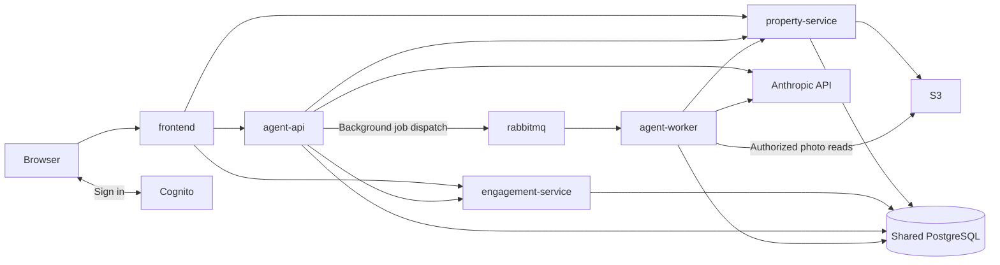

# EstateFlow AI MVP Containers

Use this reference to implement and review the proposed six-container layout. The [MVP agent details](../agent-details/agent-details.md) define user-visible agent behavior. The [MVP tech stack](../teach-stack/tech-stack.md) defines the selected tools and deployment constraints. Resolve the open decisions below before implementing the affected boundaries.

## Container directory

| Container | Job | Developer reference |
| --- | --- | --- |
| `frontend` | Serves the Next.js buyer and seller interface and calls the backend on behalf of the signed-in user. | [Frontend](frontend.md) |
| `property-service` | Owns listing drafts, property facts, photo metadata, showcase revisions, publication, and search. | [Property service](property-service.md) |
| `engagement-service` | Owns conversations, seller inquiries, approved answers, and access grants for private details. | [Engagement service](engagement-service.md) |
| `agent-api` | Runs interactive Seller and Buyer Agent workflows and accepts requests for background AI jobs. | [Agent API](agent-api/agent-api.md) |
| `agent-worker` | Runs the Property Inspector and Property Showcase Creator workflows from queued jobs. | [Agent worker](agent-worker/agent-worker.md) |
| `rabbitmq` | Delivers background job messages to the worker in the proposed RabbitMQ and Celery setup. | [RabbitMQ](rabbitmq.md) |

`agent-api` and `agent-worker` can use the same Docker image with separate startup commands. The container names describe runtime roles. The four agents are workflows within those two roles. Amazon RDS for PostgreSQL, Cognito, and S3 are shared managed AWS services. The direct Anthropic API is an external dependency.

The dispatch arrow shows logical ownership. The process that publishes from the durable dispatch record is still open. The diagram omits the browser's direct use of authorized S3 upload and download URLs.

## Cross-container rules

- Run application containers locally with Docker Compose during development. The hosted demo uses the shared AWS dependencies described in the tech stack. Expose the frontend as the user entry point and keep backend and broker traffic private.
- Keep domain writes behind the owning service. Use SQLAlchemy for Python database access. The agent processes may share workflow and job records. They use authorized service APIs for listing and engagement records.
- Treat Cognito identity, service-to-service identity, and resource permission as separate checks. A service that acts for a buyer or seller must carry verifiable actor context to the receiving service. The receiver enforces its resource rules.
- Preserve durable state before reporting success. A request can fail between services or be retried. Give important mutations stable identifiers and enforce uniqueness where it defines a product outcome.
- Keep secrets and protected property details out of frontend configuration, model inputs, logs, and broker payloads. The user may receive the approved private value through the dedicated protected result.
- Correlate requests, agent runs, jobs, and durable state changes with identifiers. Use fictional fixtures or authorized test data, and use mocks for routine model tests.

## Decisions before implementation

| Decision | What to settle |
| --- | --- |
| Service and database access | Agree how internal calls authenticate and carry user context, where protected values are stored and returned, how PostgreSQL access is scoped by owner, and which tool and process apply shared migrations. |
| Background delivery | Confirm RabbitMQ and Celery for the MVP, choose where outbox dispatch runs, and settle how local and hosted workers isolate jobs on shared AWS data. Set job retry, timeout, and terminal failure behavior. |
| API and UI contracts | Agree request and response schemas, chat delivery and refresh behavior for in-flight turns, job status updates, and the confirmation and error states each screen must handle. |
| Product and test fixtures | Decide minimum publication fields, answer visibility options, and fixtures for houses, land, and apartments. Verify the happy path, cross-user authorization, retry safety, and model output quality. |
| Hosted deployment | Choose hosting, broker persistence and recovery configuration, and a launch and smoke-test procedure that fits the remaining credits and submission requirements. |
